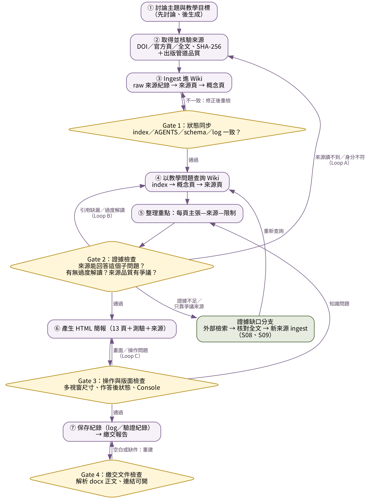

# Cat Behavior LLM Wiki × 互動式教學簡報

**「喵～原來你是這個意思！給新手毛孩父母的貓咪觀察課」**

TAICA 生成式 AI：文字與圖像生成的原理與實務｜用 LLM Wiki 做一份教學 HTML 簡報
財務金融系碩士班二年級｜1811406013 張翔鈞

## 連結

- **教學 HTML 簡報（GitHub Pages）**：https://arieslibra318.github.io/cat-behavior-llm-wiki/
- **Wiki 入口**：[index.md](index.md)

## 專案內容

| 路徑 | 說明 |
|---|---|
| [index.md](index.md) | Wiki 目錄與 ingest 狀態總覽（S01–S09） |
| [AGENTS.md](AGENTS.md) | LLM 維護指示：ingest 規則、證據缺口 loop、來源品質規則 |
| [wiki/schema.md](wiki/schema.md) | 頁面結構、證據標籤與各來源驗證清單 |
| [log.md](log.md) | 依時間追加的 ingest／query／lint 紀錄 |
| [raw/sources/](raw/sources/) | 原始來源核查紀錄（書目、DOI、核查方式） |
| [wiki/sources/](wiki/sources/) | 每份來源的知識頁（範圍、主張、限制） |
| [wiki/concepts/](wiki/concepts/) | 12 個概念頁 |
| [presentation/](presentation/) | 13 頁互動式 HTML 簡報與逐頁內容稿 |
| [loop驗證紀錄.md](loop驗證紀錄.md)、[實際執行紀錄-Q01.md](實際執行紀錄-Q01.md)、[補充檢索Loop-Q02.md](補充檢索Loop-Q02.md) | Loop 實際執行與檢查紀錄 |
| [loop-graph.png](loop-graph.png) | Loop / Graph 流程圖 |

## Loop / Graph

## 說明

- 根目錄 `index.html` 與 `presentation/index.html` 是同一份簡報，前者供 GitHub Pages 直接開啟。
- S01、S08 的論文 PDF 全文因版權未上傳；Wiki 中指向本機 PDF 副本的連結在 GitHub 上會失效，來源紀錄仍附 DOI 與官方連結可供核對。
- 本 Wiki 未經獸醫專業審查，內容僅供教學使用。
