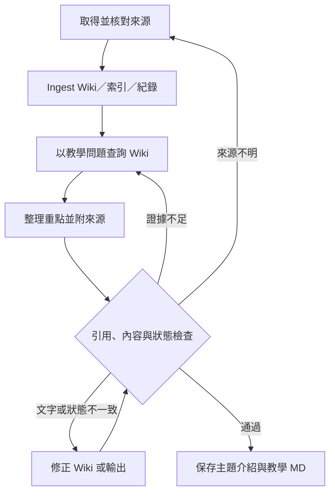

# Loop 驗證紀錄

執行日期：2026-11-22。範圍：現有 Wiki 到教學 Markdown 的文件工作流程。這是 AI 依規則執行的迴圈，未部署成自動 graph 程式。（2026-11-23 註：本段原寫「未驗證 HTML 畫面或互動」為當時狀態；HTML 實測已於文末補記完成。）

## 流程

## 一次實際執行

查詢問題：本專案要教什麼？呼嚕、慢眨眼、吃草、植物安全和窗外觀察能支持哪些結論？

檢索路徑：index → 對應概念頁／S01–S07 來源頁 → 各頁來源紀錄。產出為「主題介紹與教學重點.md」，各節引用對應來源頁。這次不重新抓取全部網站、不重算研究資料，只核對已 ingest 文件及其原有核查紀錄。

| 檢查 | 實際發現 | 修正／判定 |
|---|---|---|
| 狀態一致性 | schema 殘留多個歷史狀態段落，易被誤讀為目前待 ingest | 將規則中的目前狀態統一為七份已處理，歷史進度保留 log |
| 概念範圍 | 環境總覽有 S02 補充，卻寫「此頁只根據一篇」 | 改為五大需求主架構來自 S01、S02 補充觀察 |
| 新增重點對應 | 逐節檢查教學 MD 的七項重點是否對應來源 | 每節具來源連結，且保留限制 |
| 過度解讀 | 核對不能把慢眨眼等同愛、問卷當因果、無毒當可不限量吃 | 教學 MD 保留這三項界線 |
| 本機結構 | 檢查相對連結、七份來源頁與來源紀錄是否存在 | 結果由本次實際結構檢查追加於下方 |

## 前移檢查與反思

本次查到兩個文件一致性問題，不能據此宣稱它是所有執行中「最常」出錯的節點。可確定的是，持續追加資訊時，舊狀態與舊範圍敘述容易落後。

因此把「索引、AGENTS、schema、概念範圍是否一致」移到每次 ingest 的結束關卡；把「主張—來源—限制」移到輸出 Markdown 之前。此次發現問題後已修改文件並再檢查連結。後續 HTML 可使用通過這個關卡的 MD，但仍須另做操作與版面驗證。

## 完成界線

本次完成內容與文件結構迴圈；不等於所有外部來源永遠有效，也不等於通過獸醫專業審查。（當時狀態）HTML 簡報連結及操作檢查尚未完成。2026-11-23 更新：操作檢查已完成，見文末兩節。

實際結構複查：190 個相對檔案連結均可解析；7 份來源頁及 7 份來源紀錄存在。

## 2026-11-22 補充流程

證據不足 → 搜尋更多可靠文獻或官方資料 → 核對原文 → 新來源 ingest → 重新查詢及驗證。資料衝突時呈現分歧；缺少個案資訊則補問。搜尋後仍無證據，不生成確定論述。此為新增規則，尚未將新增搜尋記為已執行。

## 2026-11-22 HTML 瀏覽器實測與 Loop C 修正

於本機伺服器（127.0.0.1:8765）實際以瀏覽器測試 presentation/index.html（桌機 1440×900 全 13 頁；手機 390×844 抽查第 1、6、10、11、13 頁）。

| 檢查項目 | 初測結果 | 修正與複查 |
|---|---|---|
| 13 頁按鈕切頁與頁碼進度條 | 通過（第 1 頁上一頁停用、第 13 頁下一頁停用、1/13–13/13 正常） | — |
| 鍵盤快捷鍵（←/→/Home/End）與下拉選單 | 通過（URL hash #1–#13 同步更新） | — |
| 第 10 頁三題互動測驗 | 通過（答錯顯示「再想想：…」，答對顯示「答對了！…」並標註來源） | — |
| 資料來源對話框（S01–S08） | 通過（S08 明標未同儕審查預印本；開啟時方向鍵不誤切頁；關閉正常） | — |
| Console JavaScript 錯誤 | 通過（全程 0 錯誤） | — |
| 貼圖裁切（Loop C 實際觸發） | **發現問題**：第 3、5、11 頁右側露入鄰近睡覺貓耳朵；第 4 頁底部露入右下歪頭貓耳尖 | 重新將 luna-stickers-v1.png 六張貼圖各自置中排入 512×512 格（四周保留透明邊距）並重嵌進 index.html；以桌機 1440×900 複查第 3、4、5、11 頁，越界完全消除（通過） |
| 手機版 390×844 排版 | 基本通過（無水平捲軸、圖片於文字上方、底部導覽可操作） | 記錄小限制：390px 窄螢幕下底部導覽按鈕文字會折行，屬已知可微調細節 |

## 2026-11-23 最後一輪 Loop（繳交前）

| 節點 | 檢查 | 結果 | 處理 |
|---|---|---|---|
| 繳交文件 | 解析 Word 報告正文 | **未通過**：docx 正文為空字串、無圖片；log 所述 PDF 不存在 | 依範本格式重建 Word 報告並輸出 PDF |
| Wiki 結構 | 全部 .md 相對連結 | 通過：248 個連結，0 個失效 | — |
| 文件一致性 | 本檔開頭仍寫「未驗證 HTML」「尚未完成」 | 與文末實測紀錄矛盾 | 加註當時狀態與更新日期（不刪原文） |
| HTML（Loop C） | 無頭瀏覽器 1440×900、1366×768、390×844；第 10 頁三題作答後量測導覽列位置 | **發現問題**：作答後導覽列底部 955px（超出 900 視窗 55px）；1366×768 為 940px | 僅對 #s10 縮小間距與插圖寬度；複查 898px／772px，三題回饋文字正常，0 個 JS 錯誤 |
| HTML 其他頁 | 13 頁逐頁截圖、鍵盤切頁 | 通過 | — |

## 2026-11-23 來源品質 loop（Gate 2，使用者觸發）

| 節點 | 檢查 | 結果 | 處理與複查 |
|---|---|---|---|
| Gate 2 來源品質 | S05 出版商（MDPI）是否有品質爭議 | 有爭議：2014–2015 曾列 Beall's List；2023 年被 Predatory Reports 列入 | 保留 S05 並加註；教學主張改由非 MDPI 來源交叉佐證 |
| ② 取得來源 | S08 期刊正式版 | J Vet Behav 82:71–74 摘要可讀，設計與預印本一致 | S08 改以期刊版描述，細節仍標預印本 |
| ② 取得來源 | 非 MDPI 的家貓吃植物文獻 | Hart 2008（dvm360 官方版）可讀；無數字、同團隊、未提毛球 | ingest 為 S09，限制寫入來源頁 |
| Gate 1 狀態同步 | index／AGENTS／schema／log／主題介紹／計畫／簡報內容稿 | 全部更新為 S01–S09 | 連結檢查 272 個，0 個失效 |
| Gate 3 HTML | 第 6 頁、第 10 頁第 2 題、來源清單 | 1440×900、1366×768、390×844 實測；第 10 頁作答後導覽列底 898／772px；0 JS 錯誤 | 通過；已重新發布網頁版 |

## 2026-11-23 流程圖重畫（五階段版）

舊版流程圖箭頭太多、互相交叉，不易閱讀，因此重畫為 [loop-graph.png](loop-graph.png)：一條主流程分成五個階段，階段②～⑤結尾各有一道檢查關卡，未通過就回到同一階段重做；只有證據不足或來源有爭議時，才走虛線回到階段①補新來源。本檔與「教學簡報製作計畫.md」中的 Mermaid 圖為當時版本，保留作為歷史紀錄。

| 階段 | 主要步驟 | 檢查點 | 未通過時 |
|---|---|---|---|
| ① 準備與取得來源 | 討論主題、取得並核驗來源 | Loop A（讀不到就換入口） | 留在階段①重試 |
| ② 建立 Wiki | Ingest：來源紀錄 → 來源頁 → 概念頁 | Gate 1 狀態同步 | 回到 Ingest 修正 |
| ③ 整理教學內容 | 查詢 Wiki、整理「主張—來源—限制」 | Gate 2 證據檢查 | 引用錯誤 → 回查詢（Loop B）；證據不足／來源有爭議 → 回階段①補來源 |
| ④ 產生簡報 | 產生 HTML 簡報 | Gate 3 版面與操作 | 回到 HTML 修改（Loop C） |
| ⑤ 保存與繳交 | 保存紀錄、產生報告 | Gate 4 繳交檢查 | 回到報告重做 |

繳交報告第三～五節已改用上表的「階段＋檢查點」名稱，與新圖一致。
