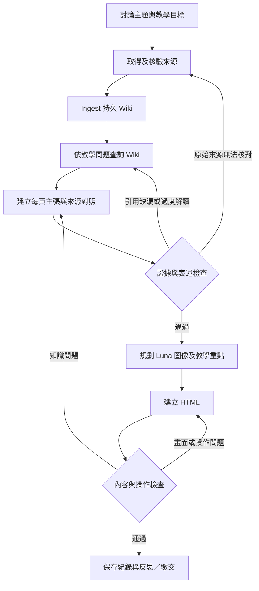

# 教學簡報製作計畫

主題：貓咪的奇怪行為，其實在表達什麼？

對象：沒有貓咪行為知識的初學者。預計 13 頁、約 8–10 分鐘。以一般貓咪的生活問題帶入，Luna 貼圖作為視覺元素，學習目標是觀察多項線索、區分研究結果與推測，以及安排友善環境。

## 作業成果與階段

| 階段 | 產出 | 狀態 |
|---|---|---|
| 討論與來源 ingest | S01–S08、來源紀錄、Wiki、log | 完成；2026-11-22 已做整體一致性同步（見 log） |
| 教學設計 | 本計畫、頁面來源對照、13 頁內容稿 | 完成（13 頁內容已逐頁確認） |
| Luna 視覺 | 角色參考與情境圖 | 六款貼圖素材板 `presentation/images/luna-stickers-v1.png` 已使用於簡報 |
| HTML 製作 | 可本機開啟的簡報、測驗及引用；不含講稿 | 已製作 `presentation/index.html`（13 頁） |
| 實際操作檢查 | 切頁、鍵盤、測驗、手機與電腦版檢查紀錄 | 已完成（2026-11-22 桌機 1440×900 與手機 390×844 實測，並修正第 3/4/5/11 頁貼圖越界，見 loop 驗證紀錄與 log） |
| 繳交說明 | 六項繳交內容與依據、反思 | 已完成（產出 `NUTC-1811406013-財金碩二-張翔鈞-Cat Behavior LLM Wiki與互動式教學簡報.docx` 與 `.pdf`） |

> 上表於 2026-11-22 更新；以下各節保留製作過程中的原始紀錄。

## Graph 與重複條件

這是由 AI 按文件規則執行、留下 Markdown 紀錄的工作流程；目前未實作為自動執行的 graph 程式。

Loop A：來源讀不到或身分不符時重找官方入口。Loop B：引用不足、把相關當因果或把群體結論套到 Luna 時，回查 Wiki 與原文。Loop C：字太小、溢出、切頁或測驗異常時修改 HTML 再檢查。前置證據檢查可減少完成排版後才重寫內容。

## 頁面與來源對照

| 頁 | 教學問題與核心內容 | 依據 | Luna 圖像用途 |
|---|---|---|---|
| 1 | 你真的看懂貓咪了嗎？三個生活提問 | 開場，不新增事實 | Luna 主視覺 |
| 2 | 如何觀察？一起看姿勢、情境和變化 | S02、S03 | 觀察者角色 |
| 3 | 哪些組合訊號顯示放鬆或緊張？ | S02、S03 | 對照插圖；標註示意 |
| 4 | 呼嚕一定是開心嗎？情境很重要 | S03 | 安靜休息／診間情境 |
| 5 | 慢眨眼研究測到了什麼？兩個實驗與限制 | S04 | 慢眨眼動作示意 |
| 6 | 吃草可能與排毛有關，但不能一概而論 | S05、S08（期刊版）、S09 | 啃草情境，不畫嘔吐細節 |
| 7 | 看到植物就能吃嗎？核對植物身分 | S07 | 與未辨識盆栽保持距離 |
| 8 | 貓咪為什麼喜歡看窗外？觀察環境與休息位置 | S01、S06 | 窗邊觀察示意，不以 Luna 個案描述 |
| 9 | 五大環境需求如何落實？ | S01 | 友善居家總覽 |
| 10 | 三題情境測驗及解釋 | S03、S05、S08、S09、S07 | 提問與回饋角色 |
| 11 | 新手毛孩父母須知：尊重互動與休息選擇 | S01、S02、S03 | 安靜陪伴貼圖 |
| 12 | 新手毛孩父母須知：植物查證與日常觀察清單 | S01、S07 | 好奇貼圖與簡潔清單 |
| 13 | 接貓回家前，準備好了嗎？（後續新增，見下方確認內容） | S01、S07 | 坐姿大貼圖搭勾選清單 |

每頁附來源編號；完整連結集中於來源頁，頁面備註保留限制。故事與生成圖標明「情境示意」，研究數據不用 Luna 插圖假裝實驗觀察照片。

## Luna 圖像規劃

先取得 Luna 的照片，確認毛色、花紋、眼睛及辨識特徵，再製作一張角色參考圖與 4–6 張可重用情境圖。預設風格為柔和手繪插畫，暖白背景搭淡紫與鼠尾草綠，保留清楚文字空間。角色不加人類式誇張笑容，姿勢示意依來源核對；圖片不內嵌教學文字，避免文字錯誤且便於修改。

圖片放在簡報的 images 資料夾；記錄參考照片、生成日期、用途及修改。尚未確認外觀前，不把任意貓圖稱為 Luna。

## 實際紀錄與反思原則

已發生的來源存取問題包括：S04 的出版社入口轉向驗證，改讀 PMC；S07 動態入口無結果，改用官方貓用清單。這些可作為來源取得迴圈的實例。另曾發現 AGENTS 狀態落後於索引，已在 S03 更新時修正。

目前沒有各節點錯誤次數的完整統計，不能宣稱某節點「最常出錯」。HTML 尚未建立，也不能宣稱介面測試已通過。後續每次檢查記錄問題、所在節點、修正及複查結果；完成後依實際證據回答反思題。

前置檢查新增：每次 ingest 完成同時核對 index、AGENTS 與 log 狀態；每頁排版前核對主張、來源及限制；Luna 圖像生成前核對角色參考與動作。

## 2026-11-22 使用者調整

簡報第 8 頁以一般貓咪為主體。Loop 流程、兩項文件一致性修正、複查結果與作業反思，納入後續作業 Word 報告，不作為簡報第 11、12 頁。Word 尚未生成。簡報保留逐頁來源編號與可展開完整參考資料，方便追溯。

第 11、12 頁內容已經使用者確認：11 為互動與休息選擇；12 為植物查證與日常觀察。

## 新增第 13 頁（使用者確認）

接貓回家前的準備：安靜適應空間、躲藏與休息處、分開的生活資源及植物安全檢視。以 S01／S07 為基礎，詳細內容仍待逐頁確認。

## 第 6 頁確認內容

標題：吃草可能與排毛有關，但不能一概而論。

- S05：飼主問卷不支持將排毛球視為普遍吃草動機。
- S08：兩隻貓六份吐出物的顯微觀察，提供植物微結構纏住毛髮的初步證據。
- 限制：S08 使用未經同儕審查的預印本全文；樣本小、無對照，不能證明普遍目的或預防效果。

本頁結論已獲使用者確認；下一步先確認其餘頁面重點，再製作 HTML。

## 第 13 頁確認內容

使用者已確認：安靜適應空間與躲藏處；分開安排食物、飲水、砂盆及休息位置；抓抓、遊戲與可到達棲架；植物安全查證；自主探索及接近／退開選擇。依據 S01、S07。

## 視覺方向確認

已確認：大貼圖、圖文各半。封面標題「喵～原來你是這個意思！」；副標「給新手毛孩父母的貓咪觀察課」。兩頁樣稿位於 presentation/preview.html，待使用者審閱，尚非完整簡報。

## 2026-11-23 來源品質調整（使用者確認）

使用者指出 S05 為 MDPI 出版。採方案：保留 S05 並加註，新增 S09（Hart 2008）佐證「吃前多半無不適」，S08 改以期刊版描述。第 6 頁、第 10 頁第 2 題及來源清單同步修改。
